# Team Planning – plan in periods, review, and meet as a team in Redmine

Team Planning replaces the weekly planning spreadsheet or wiki page with a board in
Redmine. Everyone plans their own period (one week by default, up to four), closes it
with a short review, and the team meeting shows all plans side by side – by person or by
project. Issues stay Redmine issues: status, assignee and comments change through Redmine,
with Redmine's permissions and workflows.

- **Board** – backlog, the current period, the next three periods and *Later* as
  columns. Drag issues between them, reorder within a column, or use the *⋯* menu
  (also on touch devices). The number of issues is the key figure: each period has a
  limit per person; above it the column is marked as overfull, but nothing is blocked.
  Hours can be planned per issue with one click, optionally.
- **Pool** – the backlog switches between *Mine* and *Pool*: unassigned open issues
  changed in the last months. Dragging one into a period assigns it.
- **Ongoing topics** – recurring work (social media, maintenance) sits in its own slim
  area at the top of every period, runs every week and does not count against the limit.
  Drag an issue in to make it an ongoing topic, drag it out to make it a normal task.
- **Long-running issues** – mark an issue as long-running, optionally with a target
  week; it moves on without asking. Issues carried over three times ask once what to do.
- **Absence** – days of absence per period lower the limit proportionally.
- **Ticking off with completion actions** – ticking an issue off means *my part is done*.
  Configurable actions decide what happens to the issue, e.g. *Invoice*: status
  *For Billing*, assigned to whoever has the role *Billing* in the project, with a comment
  "Done in week 48, 3.5 h logged". Actions the workflow does not allow are disabled with
  the reason. *Undo* restores status and assignee.
- **Closing a period** – summary (done, continuing on purpose, to decide, hours logged),
  one decision per open issue (next period, backlog, close), a short review (went well,
  less well, what we change), personal notes and the focus for the next period. Under five
  minutes. Reviews and notes use Redmine's text formatting (Markdown or Textile, `#123`
  links), notes with the usual editor toolbar.
- **Earlier periods** – step back through closed periods right on the board (‹ ›), or open
  a period's page: summary, every issue with its result and hours, the focus, the review
  (went well, less well, what we change), personal notes and the notes of the team meetings
  held in that period – all editable afterwards by the owner or a project lead. *Earlier periods* lists them all with the first lines of each review.
- **Closings** – who has closed their period: for each week, everyone with *closed on …*
  (linking to the period's review), *not closed yet*, *behind since KW 46* or *runs until
  KW 49* for longer periods. Those who still have to close come first. Opens on the week
  before the next team meeting; ‹ › steps through other weeks.
- **Team meeting** – all plans by person or by project (customer), with who is prepared,
  the last review, focus, load and what to talk about; meeting notes for topics that
  belong to nobody; an email reminder the day before to everyone not prepared yet.
- **My page block "Planning"** – the issues of the period with a tick box and quick time
  logging (+0.5, +1, +2 or a number and Enter; comment, activity and day on demand).
  Step back to the previous period to log time late.

*Planning*, *Team meeting* and *Closings* are tabs at the top of every page (the latter two
for everyone who plans themselves).

Everything you change shows a message with *Undo*. Others' plans are read-only unless your
role may edit them (e.g. project lead); the owner gets an email about the change.

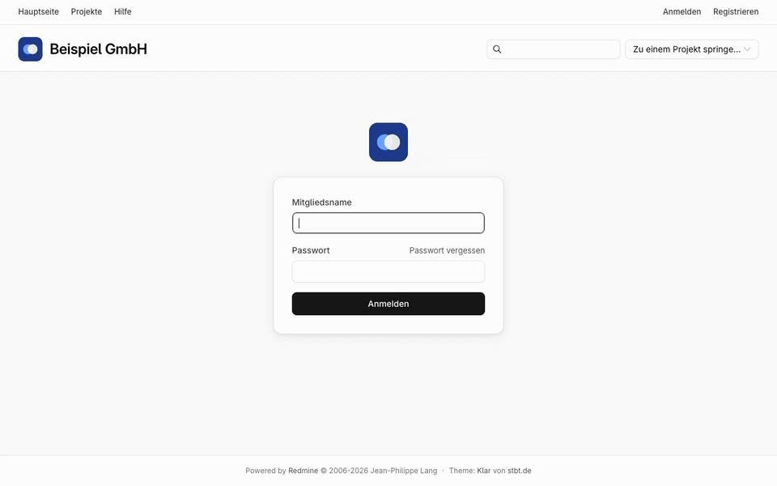

*30 seconds: drag an issue into the week, move one on, plan hours, tick off with
“Invoice”, log an hour on My page, open the team meeting.*
[Video as MP4](docs/screenshots/demo.mp4)

## Screenshots

**Board** – backlog, last period (folded), the current period with ongoing topics, and the
next periods.

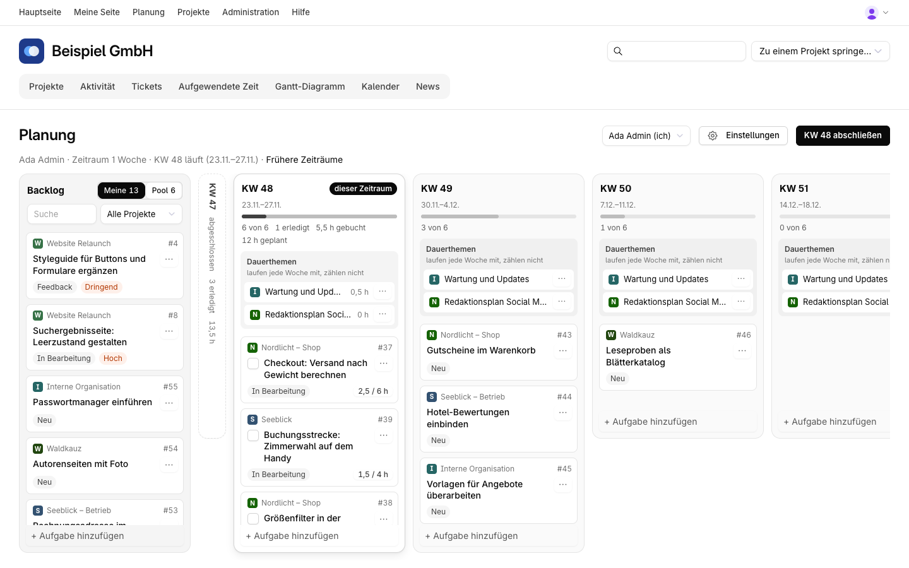

| Ticking off with completion actions | Pool of unassigned issues |
| --- | --- |
| 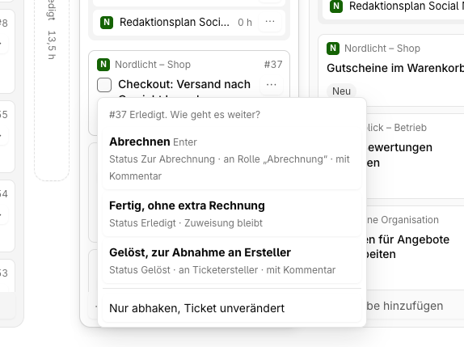 | 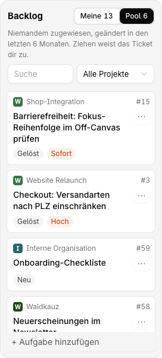 |

**My page block “Planning”** – tick off and log time without opening the board.

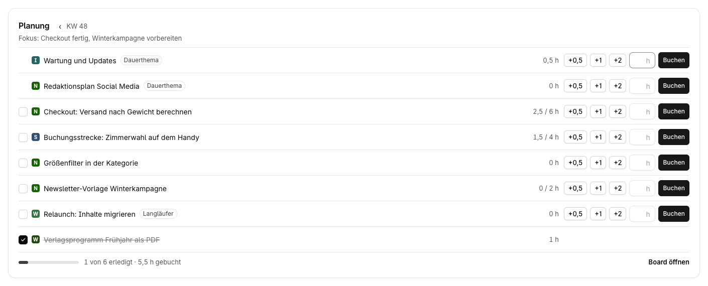

**Closing a period** – summary, one decision per open issue, review and focus.

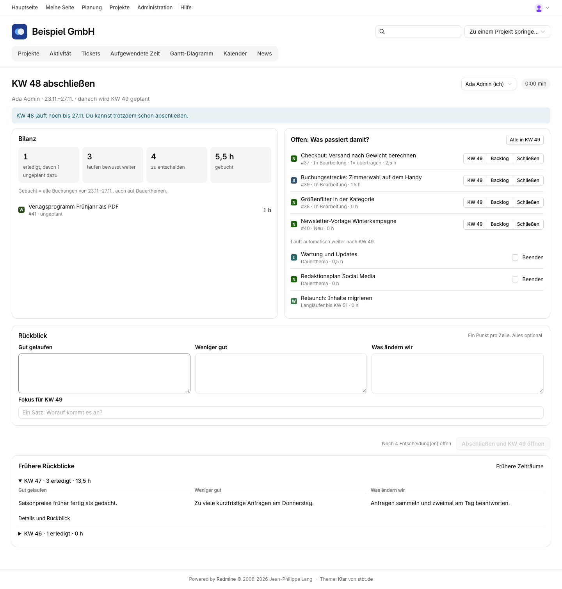

**Earlier period** – summary, issues with results, focus, meeting notes and review.

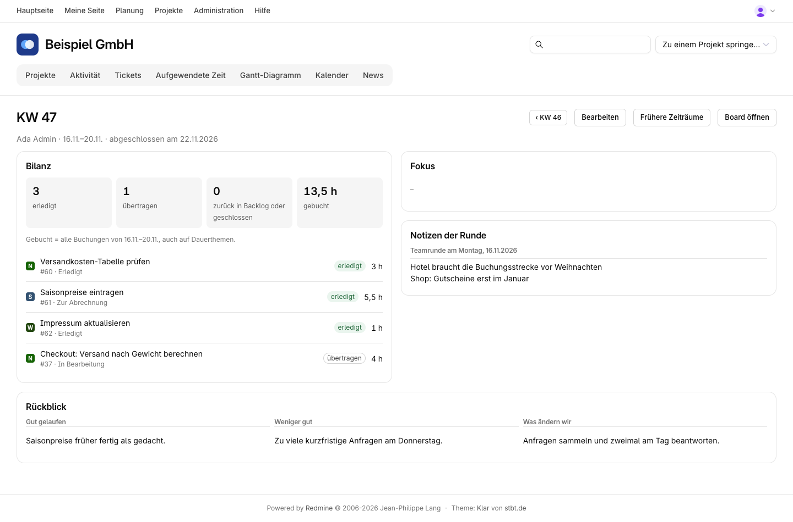

**Team meeting** – by person and by project.

| By person | By project |
| --- | --- |
| 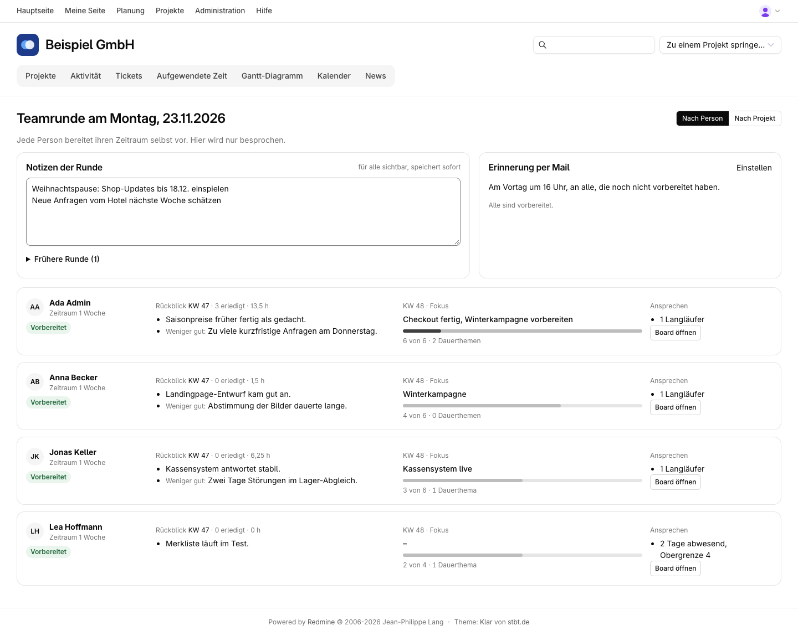 | 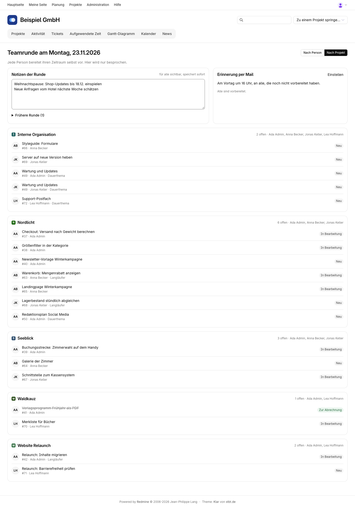 |

| On the phone | |
| --- | --- |
| 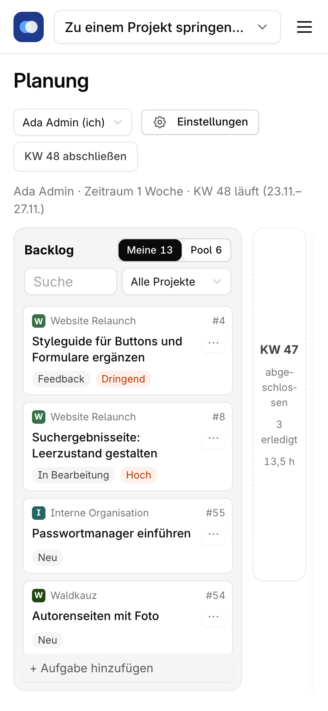 | 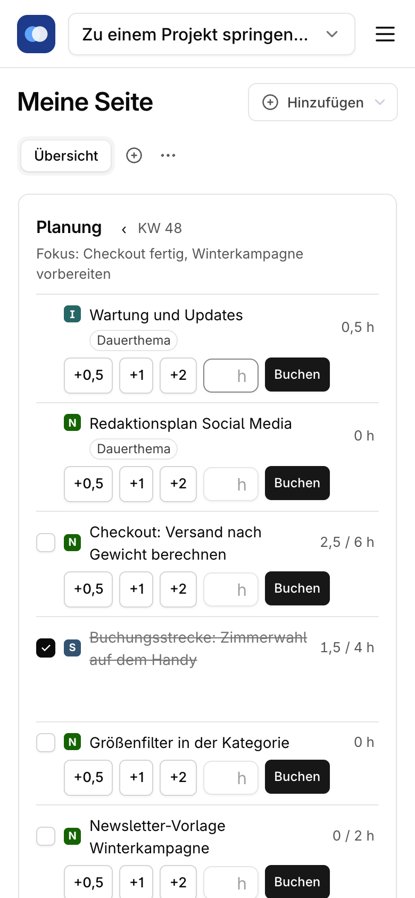 |

## Installation

The folder in `plugins/` must be named `redmine_team_planning`.

```sh
cd /path/to/redmine/plugins
unzip redmine-team-planning-v*.zip          # creates redmine_team_planning/
cd ..
bundle exec rake redmine:plugins:migrate NAME=redmine_team_planning RAILS_ENV=production
```

Restart Redmine. Requires Redmine 6.0 or newer; tested with 7.0, 6.1 and 6.0.

**Updating:** replace the plugin folder, run the same `redmine:plugins:migrate` command
(it does nothing when there is no new migration) and restart Redmine.

## Setting it up step by step

A clean setup takes about 20 minutes. Do it in this order – later steps rely on
earlier ones.

### 1. Permissions

*Administration → Roles and permissions*, section *Project*:

| Permission | Meaning | Typically for |
| --- | --- | --- |
| Team Planning: own planning | plan your own periods (shows *Planning* in the top menu) | everyone who plans |
| Team Planning: view others' planning | see the board of colleagues, read-only | everyone in the team meeting |
| Team Planning: edit others' planning | change colleagues' plans | project leads |

Planning is cross-project: a permission counts as soon as you have it in any project. You
only ever see issues you may see in Redmine; others appear as "1 issue without permission".
Everyone who should appear in the team meeting needs *own planning* in at least one project.

### 2. Statuses and roles for what happens after “done”

Ticking an issue off means *my part is done* – what happens next is up to you. Decide
this first, because the completion actions refer to statuses and roles:

- **A status for issues to invoice** (e.g. *For Billing*), if you do not have one:
  *Administration → Issue statuses → New status*, not closed.
- **A role for whoever invoices** (e.g. *Billing*): *Administration → Roles and
  permissions → New role*, with *Issues can be assigned to this role* (on by default),
  *View issues*, *Edit issues* and *Add notes*. Add the
  person with this role to the projects (or to the parent customer project with
  inheritance). The action then assigns the issue to whoever has the role in the issue's
  project.
- **Workflow**: *Administration → Workflow* – the roles that tick off must be allowed to
  move issues into the target statuses (from all statuses an issue can be in while
  planned). Actions the workflow does not allow are shown disabled with the reason, so
  missing transitions show up immediately.

### 3. Completion actions and the plugin settings

*Administration → Plugins → Team Planning → Configure*:

- **Completion actions** – one row each: label, new status, assignee (*keep*, *issue
  author* or a project role), whether to add a comment, and optionally the projects the
  action applies to. The first matching action is preselected (Enter). A typical set:

  | Label | Status | Assignee | Comment |
  | --- | --- | --- | --- |
  | Invoice | For Billing | role *Billing* | yes |
  | Done, no extra invoice | Closed | keep | no |
  | Resolved, for acceptance | Resolved | issue author | yes |

  Without any action, ticking off only marks the issue in the plan and leaves it unchanged.
- **Comment template** – placeholders `{zeitraum}` (period), `{stunden}` (hours logged),
  `{person}`, `{datum}`.
- **Count as done** – statuses that tick an issue off automatically (e.g. when someone
  closes it in Redmine), and that are left out of backlog and pool. *Automatic*: all
  closed statuses plus *Resolved*, *For Billing*, *Gelöst* and *Zur Abrechnung* – names
  are compared without emoji, punctuation and case, so "✅ Resolved" counts too. *Choose*:
  tick the statuses yourself.
- **Pool** – how many months back unassigned issues are offered.
- **Tracker for new tasks** – used by *Add task* on the board (default: *To-Do* if the
  project has it, else its first tracker).
- **Team meeting** – weekday of the meeting, the email reminder (time and recipients) and
  the email to a person when someone else changes their plan.

### 4. Email reminder before the team meeting

Redmine must be able to send email (*Administration → Settings → Email notifications*).
Then run the reminder task hourly by cron; it sends once per meeting when the configured
time is reached:

```sh
# crontab of the Redmine user
0 * * * * cd /path/to/redmine && bundle exec rake redmine:team_planning:send_reminders RAILS_ENV=production
```

### 5. My page

Each person adds the block *Planning* on *My page → Add*. It shows the issues of the
current period with a tick box and quick time logging.

### 6. Taking over a "planning week" list field (optional)

If you planned with a list custom field ("KW 01" … "KW 53", "Backlog"), take the values
over once. Weeks become periods of the assigned person, past weeks land in the current
period as carried over, "Backlog" stays in the backlog. The field itself is not changed,
so you can compare before you remove it.

```sh
bundle exec rake redmine:team_planning:import_planning_week FIELD="Planning Week" YEAR=2026 RAILS_ENV=production
```

Back up the database before, as with every bulk change.

### 7. First week with the team

- Everyone opens *Planning*, sets the period length and limit (*Settings* on the board;
  one week and six issues is a good start), drags recurring work into *Ongoing topics*
  and plans the first period.
- Before the team meeting everyone closes their own period (*Close KW 48* on the board) –
  that is what marks them as prepared. The *Closings* tab shows who has done it so far.
- In the meeting, open the *Team meeting* tab: go through the people, or switch to
  *By project*; notes that belong to nobody go into the meeting notes.

## Development

```sh
dev/run-tests.sh                      # plugin tests against Redmine 7.0 (Docker)
REDMINE_VERSION=6.1 dev/run-tests.sh  # 6.1, 6.0
npm install && dev/check-ui.sh        # browser run against the local instance;
                                      # backs up and restores its database
```

## License

MIT
